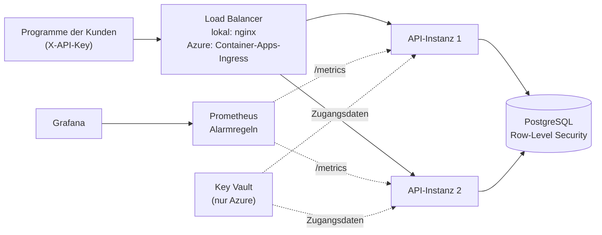

# Kennzahlen-Plattform

Eine API, über die mehrere Firmen ihre Buchungsdaten hochladen und Controlling-Kennzahlen abrufen: Umsatz, Deckungsbeitrag, Betriebsergebnis je Kostenstelle und Abweichungen vom Budget. Die Kennzahlen selbst sind einfach. Im Mittelpunkt steht, was ein System für viele Kunden im Betrieb braucht: saubere Trennung der Kunden, Ausfallsicherheit, Monitoring, Infrastruktur als Code und nachvollziehbar dokumentierte Entscheidungen.

| Thema | Umsetzung | Nachweis |
|---|---|---|
| Mehrere Mandanten | gemeinsame Datenbank, Trennung durch Row-Level Security in PostgreSQL | `tests/test_mandantentrennung.py`, [ADR 0001](docs/adr/0001-gemeinsame-datenbank-mit-row-level-security.md) |
| Security | API-Schlüssel nur als Hash, eingeschränkte Datenbankrolle, Anfragebegrenzung je Mandant, Zugangsdaten im Key Vault | `tests/test_api.py`, `tests/test_ratelimit.py`, ADR [0002](docs/adr/0002-api-schluessel-als-hash.md), [0004](docs/adr/0004-anfragebegrenzung-im-speicher.md) |
| Hochverfügbarkeit | zwei zustandslose Instanzen hinter einem Load Balancer, getrennte Health- und Readiness-Prüfung | `scripts/ausfalltest.py`, [ADR 0003](docs/adr/0003-zustandslose-instanzen.md) |
| Monitoring | Prometheus-Metriken je Mandant, Grafana-Dashboard, Alarmregeln, Logs als JSON | `tests/test_beobachtung.py`, `monitoring/alarme_test.yml`, [ADR 0006](docs/adr/0006-metriken-mit-mandant-als-label.md) |
| Cloud und Terraform | Azure Container Apps, PostgreSQL Flexible Server, Key Vault | `infra/tests/`, [ADR 0005](docs/adr/0005-azure-container-apps-und-terraform.md) |

## Architektur



Jede Anfrage läuft in einer Transaktion, in der die API den Mandanten setzt. Ab da zeigt und akzeptiert die Datenbank nur noch Zeilen dieses Mandanten. Die Abfragen im Code enthalten absichtlich keinen Mandantenfilter. Die Tests zeigen, dass trotzdem nichts durchrutscht: Selbst ein `DELETE FROM buchungen` ohne Bedingung löscht nur die eigenen Zeilen.

## API

Die vollständige Beschreibung erzeugt FastAPI unter `/docs`.

| Methode | Pfad | Zweck |
|---|---|---|
| POST | `/v1/buchungen` | bis zu 10.000 Buchungen hochladen |
| DELETE | `/v1/buchungen?jahr=&monat=` | Zeitraum löschen, um ihn neu zu laden |
| PUT | `/v1/budget` | Budget anlegen oder überschreiben |
| GET | `/v1/kennzahlen?jahr=&monat=` | Deckungsbeitragsrechnung, gesamt und je Kostenstelle |
| GET | `/v1/abweichungen?jahr=&monat=` | Ist gegen Budget, größte Abweichung zuerst |
| GET | `/health`, `/ready` | Lebt der Prozess? Ist die Datenbank erreichbar? |

Beispiel mit den Demodaten einer erfundenen Tischlerei (`scripts/demo_daten.py`):

```bash
curl -H "X-API-Key: $SCHLUESSEL" "http://localhost:8080/v1/kennzahlen?jahr=2025"
```

```json
{
  "jahr": 2025,
  "monat": null,
  "gesamt": {
    "umsatz": 1046482.73,
    "variable_kosten": 334830.14,
    "deckungsbeitrag": 711652.59,
    "db_quote": 0.68,
    "fixkosten": 636930.43,
    "betriebsergebnis": 74722.16,
    "umsatzrendite": 0.0714
  }
}
```

Bei den Abweichungen steht ganz oben, dass die Werkstatt 22.240 € weniger Umsatz gemacht hat als geplant (−3,0 %) und das Material 11.504 € teurer war (+4,6 %). Beides ist als ungünstig markiert: Mehr Erlös als geplant ist günstig, mehr Kosten sind ungünstig.

## Starten

Lokal mit Docker, alles in einem Schritt:

```bash
docker compose up -d --build
docker compose run --rm einrichten python -m scripts.mandant anlegen "Muster GmbH"
python -m scripts.demo_daten --schluessel <Schlüssel aus der Zeile davor>
```

| Dienst | Adresse |
|---|---|
| API mit Dokumentation | http://localhost:8080/docs |
| Grafana (Dashboard „Betrieb je Mandant“) | http://localhost:3000 |
| Prometheus | http://localhost:9090 |

Ausfalltest und Lasttest gegen den laufenden Stack:

```bash
python -m scripts.ausfalltest
pip install -r requirements-dev.txt
KENNZAHLEN_SCHLUESSEL=kz_... locust -f lasttest/locustfile.py --host http://localhost:8080 --headless -u 50 -r 10 -t 60s
```

In Azure (braucht ein eigenes Konto und kostet laufend Geld, in der kleinsten Variante grob geschätzt einige Euro pro Tag):

```bash
cd infra
terraform init
terraform apply -var subscription_id=... -var image=ghcr.io/<benutzer>/kennzahlen-plattform:1.0.0
# danach einmal das Schema einspielen, den Befehl gibt Terraform aus
```

## Was getestet ist

GitHub Actions führt bei jedem Push vier Jobs aus:

- **tests:** 49 Tests mit pytest gegen ein echtes PostgreSQL. Dazu gehören elf Tests zur Mandantentrennung direkt in der Datenbank: fremde Zeilen lesen, schreiben, ändern, löschen, sich selbst zuordnen und RLS abschalten scheitert. Außerdem Anmeldung, Schlüsseltausch, Eingabeprüfung, Kennzahlen gegen unabhängig nachgerechnete Werte, Anfragebegrenzung, Metriken und Logformat.
- **monitoring:** Prometheus-Konfiguration prüfen und Unit-Tests der Alarmregeln: Fehlerquote eines Mandanten, Ausfall einer Instanz, langsame Antworten.
- **terraform:** `fmt`, `validate` und `terraform test`. Die Tests ersetzen den Azure-Provider durch Attrappen und prüfen unter anderem, dass die Datenbank-URL nur aus dem Key Vault kommt und dass immer mindestens zwei Instanzen laufen.
- **ausfalltest:** startet den ganzen Stack mit Docker Compose, beendet während laufender Anfragen eine Instanz hart und startet sie wieder. Bestanden ist der Test nur, wenn keine einzige Anfrage fehlschlägt.

Dass die Tests Fehler wirklich finden, habe ich geprüft: Mit abgeschalteter Row-Level Security schlagen 12 Tests fehl, mit einer Datenbank-URL im Klartext der Terraform-Test, mit einer zu hohen Fehlerschwelle der Alarmtest.

Lasttest, nur als grobe Orientierung: Eine einzelne Instanz auf einem Rechner mit zwei Kernen, den sie sich mit Datenbank und Lastgenerator teilt, schaffte rund 310 Anfragen pro Sekunde, p95 unter 80 ms, ohne Fehler. Mit der Standardbegrenzung (600 Anfragen pro Minute je Mandant) wurden bei derselben Last 87 % der Anfragen mit 429 abgelehnt. So soll es sein.
