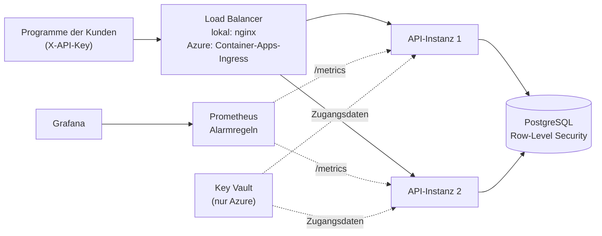

# Kennzahlen-Plattform

Eine API, über die mehrere Firmen ihre Buchungsdaten hochladen und Controlling-Kennzahlen abrufen: Umsatz, Deckungsbeitrag, Betriebsergebnis je Kostenstelle und Abweichungen vom Budget. Die Kennzahlen selbst sind einfach. Im Mittelpunkt steht, was ein System für viele Kunden im Betrieb braucht: saubere Trennung der Kunden, Ausfallsicherheit, Monitoring, Infrastruktur als Code und nachvollziehbar dokumentierte Entscheidungen.

| Thema | Umsetzung | Nachweis |
|---|---|---|
| Mehrere Mandanten | gemeinsame Datenbank, Trennung durch Row-Level Security in PostgreSQL | `tests/test_mandantentrennung.py`, [ADR 0001](docs/adr/0001-gemeinsame-datenbank-mit-row-level-security.md) |
| Security | API-Schlüssel nur als Hash, eingeschränkte Datenbankrolle, Anfragebegrenzung je Mandant, Zugangsdaten im Key Vault | `tests/test_api.py`, `tests/test_ratelimit.py`, ADR [0002](docs/adr/0002-api-schluessel-als-hash.md), [0004](docs/adr/0004-anfragebegrenzung-im-speicher.md) |
| Hochverfügbarkeit | zwei zustandslose Instanzen hinter einem Load Balancer, getrennte Health- und Readiness-Prüfung | `scripts/ausfalltest.py`, [ADR 0003](docs/adr/0003-zustandslose-instanzen.md) |
| Monitoring | Prometheus-Metriken je Mandant, Grafana-Dashboard, Alarmregeln, Logs als JSON | `tests/test_beobachtung.py`, `monitoring/alarme_test.yml`, [ADR 0006](docs/adr/0006-metriken-mit-mandant-als-label.md) |
| Cloud und Terraform | Azure Container Apps, PostgreSQL Flexible Server, Key Vault | `infra/tests/`, [ADR 0005](docs/adr/0005-azure-container-apps-und-terraform.md) |

## Architektur

Jede Anfrage läuft in einer Transaktion, in der die API den Mandanten setzt. Ab da zeigt und akzeptiert die Datenbank nur noch Zeilen dieses Mandanten. Die Abfragen im Code enthalten absichtlich keinen Mandantenfilter. Die Tests zeigen, dass trotzdem nichts durchrutscht: Selbst ein `DELETE FROM buchungen` ohne Bedingung löscht nur die eigenen Zeilen.
